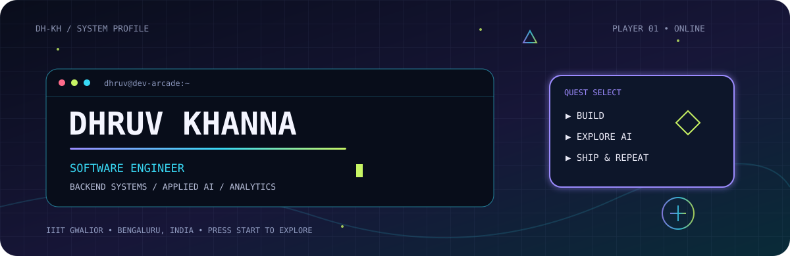

<div align="center">



<a href="https://www.linkedin.com/in/dhruvkhanna930/"></a>
<a href="https://dhruvkhanna930.vercel.app/"></a>
<a href="https://github.com/dhruvkhanna930"></a>

<br/>


</div>

---

## `01 / PLAYER PROFILE`

```yaml
player       : Dhruv Khanna
class        : Software Engineer
base         : Bengaluru, India
guild        : Morgan Stanley — Institutional Securities Technology
specialty    : Backend Engineering • Applied AI • Data & Analytics
education    : B.Tech, Computer Science — IIIT Gwalior
current_mode : Building reliable systems, exploring AI, breaking things (responsibly)
```

I’m a software engineer who enjoys turning messy, complex problems into useful products. I work across backend systems, data-heavy applications and applied AI — with a soft spot for automation, thoughtful engineering and projects that make people say *“wait, you built that?”*

At Morgan Stanley, I work in the **Client Portfolio Risk & Margins (CPRM)** space within Institutional Securities Technology. My work involves engineering around data-intensive workflows and internal tooling.  
*(Internal systems and details are intentionally kept high-level.)*

## `02 / SELECT YOUR QUEST`

<div align="center">

| 🕹️ QUEST | WHAT'S INSIDE | STATUS |
|:--|:--|:--:|
| **[INVESTRIX](https://github.com/dhruvkhanna930/investrix)** | AI-assisted portfolio research, risk insights, diversification analytics, sentiment and forecasting | `BUILT` |
| **[RAFTA](https://github.com/dhruvkhanna930/RAFTA)** | RAG security research: hybrid semantic + invisible-Unicode attacks, evaluation and defence analysis | `RESEARCH` |
| **[URINE STRIP ANALYZER](https://github.com/dhruvkhanna930/UrineStripAnalyzer)** | Image-based strip analysis with a Django/DRF backend and React interface | `BUILT` |
| **MARGIN SUMMARISER** | LangGraph-based multi-agent assistant for current, historical and general margin-related queries | `INTERNAL` |

</div>

<details>
<summary><b>🔍 Open the RAFTA research log</b></summary>

RAFTA (RAG Forensics and Threat Analysis) explores how retrieval-augmented generation systems can be manipulated through combined semantic prompt injection and invisible Unicode character techniques. The work evaluates multiple RAG architectures and examines practical defensive layers such as Unicode normalisation, zero-width character removal and perplexity-based filtering.

</details>

<details>
<summary><b>🧠 Open the Investrix build notes</b></summary>

Investrix brings together portfolio tracking and analytical signals: risk profiling, diversification and concentration views, fundamental similarity, news sentiment analysis and time-series forecasting. The goal is to make portfolio information easier to interpret — not to pretend that a model can predict markets perfectly.

</details>

## `03 / THE LOADOUT`

<div align="center">


</div>

**Core languages & backend:** Python, SQL, Django, Django REST Framework, FastAPI  
**Data & infrastructure:** PostgreSQL, Redis, Sybase, pyODBC, Docker  
**Frontend:** React, Vite, Tailwind CSS  
**AI / data:** LangGraph, RAG, ChromaDB, Sentence Transformers, Ollama, NLP, analytics  
**Workflow:** Git, GitHub, API design, automation, debugging

## `04 / ARCADE MODE`

<div align="center">


**Achievement unlocked:** You made it this far. +100 XP.  
*The bugs are not a feature. The occasional side quest is.*

</div>

A GitHub README cannot safely host a playable JavaScript game or iframe, so this arcade section uses animated visuals and expandable “quest logs” instead of fake game controls. The contribution snake becomes your live arcade animation once the workflow below is enabled.

## `05 / PLAYER STATS`

<div align="center">


</div>

## `06 / OFF-DUTY SIDE QUESTS`

- 🎧 Music on repeat — Charlie Puth, Ed Sheeran and whatever gets stuck in my head.
- 🍳 Cooking — because feeding people is a pretty good love language.
- 🛠️ DIY builds — turning random everyday stuff into things it probably had no business becoming.
- 🎌 Anime, tech rabbit holes and spontaneous food discoveries.

## `07 / FINAL BOSS: SAY HELLO`

<div align="center">

**Have an interesting engineering problem, a fun build idea, or just want to talk tech?**

<a href="https://www.linkedin.com/in/dhruvkhanna930/"></a>
<a href="https://dhruvkhanna930.vercel.app/"></a>

<br/><br/>


<sub>Made with curiosity, caffeine, and an unreasonable number of browser tabs.</sub>

</div>
